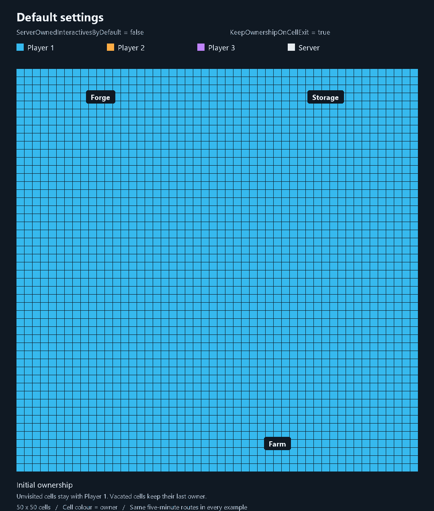
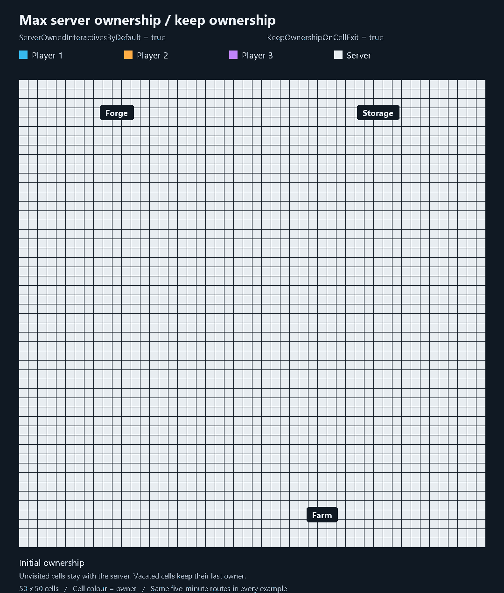
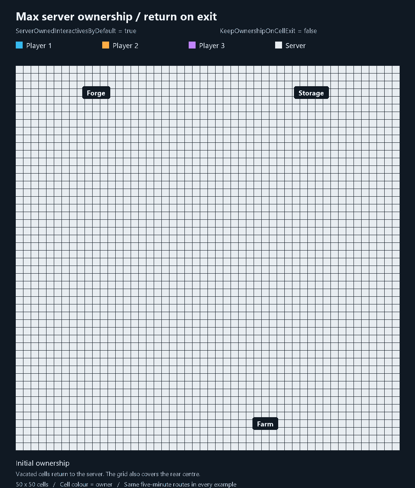
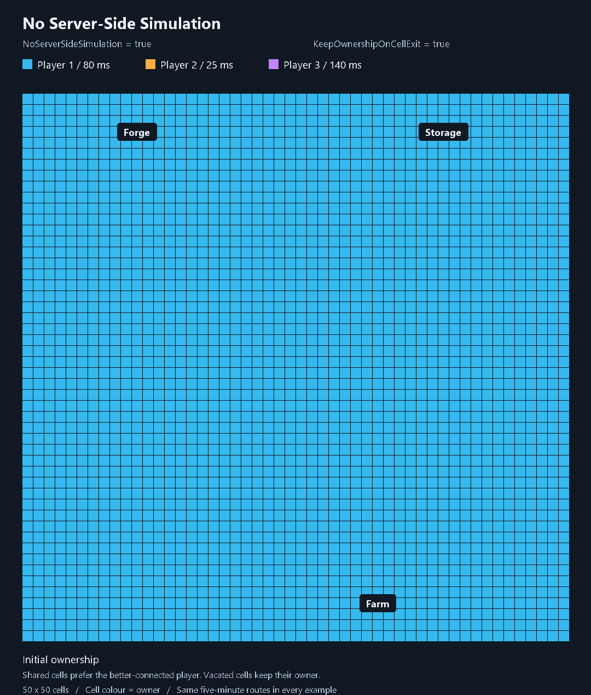

# Ownership over time

The same 50 x 50-cell base and the same five-minute player routes in four modes. Each player takes different irregular routes around the forge, storage and farm, keeps moving during their meeting, then returns to a separate work area. Playback is twenty times normal speed, followed by a 3-second final hold.

Blue = Player 1. Orange = Player 2. Purple = Player 3. White = server. Colours represent grid-managed object ownership; small outlines show player coverage. No game objects are drawn. The illustration keeps all shown areas loaded, with idle, ready objects and default grid timers. Static pieces outside the static grid are not shown.

## 1. Default settings

`ServerOwnedInteractivesByDefault=false`, `KeepOwnershipOnCellExit=true`.

Player 1 initially owns the base. Arriving players claim their routes and work areas. Overlaps use the server; vacated cells keep their last owner.

## 2. Max server ownership, keep ownership

`ServerOwnedInteractivesByDefault=true`, `KeepOwnershipOnCellExit=true`.

The server initially owns all shown cells. Players leave ownership trails along the same routes; unvisited cells stay with the server.

## 3. Max server ownership, return on exit

`ServerOwnedInteractivesByDefault=true`, `KeepOwnershipOnCellExit=false`.

Vacated cells return to the server. Player ownership stays around their current work areas; this mode also includes the rear centre in player coverage.

## 4. No Server-Side Simulation

`NoServerSideSimulation=true`, `KeepOwnershipOnCellExit=true`.

Ownership stays with players. Example pings: Player 1 = 80 ms, Player 2 = 25 ms, Player 3 = 140 ms. Shared cells favour Player 2's better connection; small ping differences can retain the current candidate.

The matching PNG files show the final distributions. `comparison-preview.png` compares initial, shared and final states for every mode. The wiki configuration page is prepared separately; its GitHub image links require the media to be pushed before they work online.
