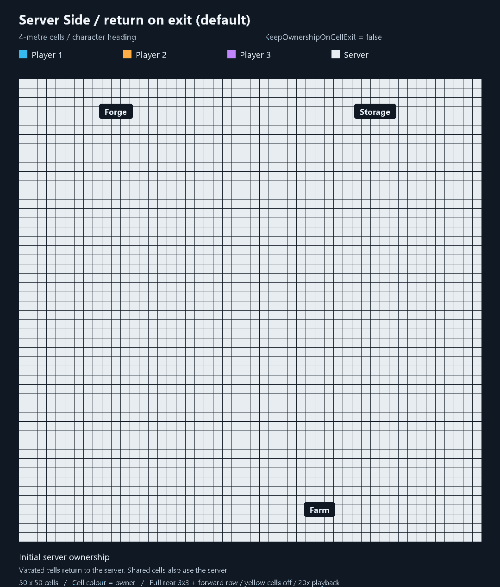
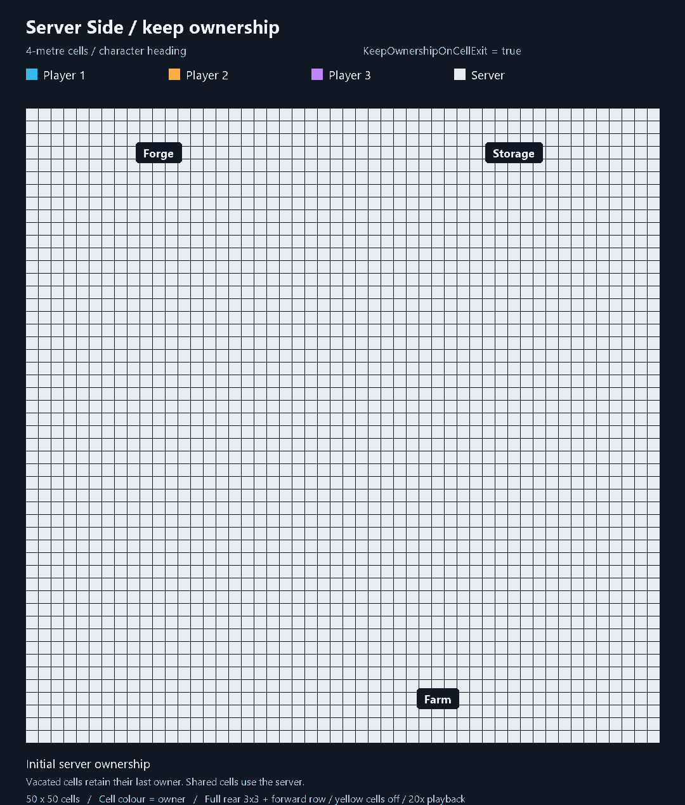

# Server Side ownership examples

The actual Server Side directional grid: full rear 3x3, three forward cells, yellow outer cells disabled. Character heading determines direction. Fast movement changes the forward delay to zero; the footprint stays the same. These example players do not trigger high-ping expansion.

The same three players move around a 50 x 50-cell base. Blue, orange and purple identify players; white means the server. Small outlines show their actual production grid coverage. Only grid-managed, idle, ready objects are represented; static buildings outside the grid stay server-owned.

## Return on exit (default) — CPU: mostly server

`KeepOwnershipOnCellExit=false`. Vacated fields return after the retirement delay; exclusive player fields run locally, shared fields use the server.

## Keep ownership — CPU: shared

`KeepOwnershipOnCellExit=true`. Players leave ownership trails; untouched and shared cells stay with the server. Both modes use the same full-rear footprint.

Playback is 20x, with a 3-second final hold. See `../../tools/ownership-examples/README.md` for generation and the limits of the illustration.
